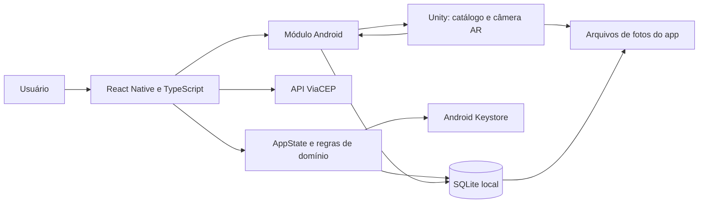

# Arquitetura do DecorIt

Este documento descreve a implementação atual do protótipo. O aplicativo é local e combina uma interface React Native com a visualização 3D e AR do Unity. Não há servidor próprio nem sincronização entre aparelhos implementados.

## Visão geral

| Parte | Responsabilidade | Arquivos principais |
| --- | --- | --- |
| React Native | Navegação, formulários, clientes, registros, fotos e acesso ao AR | `mobile/App.tsx`, `mobile/src/screens.tsx` |
| Estado e domínio | Operações, validações, montagem dos dados e atualização das telas | `mobile/src/state/AppState.tsx`, `mobile/src/data/clientDomain.ts` |
| Banco e proteção | SQLite, esquema Drizzle, transações e campos protegidos | `mobile/src/data/clientStorage.ts`, `mobile/src/data/schema.ts`, `mobile/android/app/src/main/java/com/com.weslerbecker.decorit/SecureFieldsModule.kt` |
| Android/Unity | Abre a Activity Unity e passa o contexto selecionado | `UnityArModule.kt`, `ImmersiveUnityPlayerActivity.kt`, `Assets/Scripts/UnityARHostBridge.cs` |
| Unity | Catálogo, prévia, câmera AR, posicionamento, gestos e captura | `Assets/Scripts/UI/CatalogScreenController.cs`, `ARPlacementController.cs`, `ARPhotoCapture.cs` |
| Cortina procedural | Configuração, camadas, pregas e materiais | `CurtainViewSettings.cs`, `CurtainController.cs`, `ProceduralCurtainMesh.cs` |

Os arquivos Kotlin citados ficam em `mobile/android/app/src/main/java/com/com.weslerbecker.decorit/`; os scripts Unity, em `Assets/Scripts/`, salvo quando indicado outro caminho.

## Navegação e comunicação

`App.tsx` organiza as abas e a navegação de detalhes. `AppStateProvider` carrega os dados, mantém o estado em memória e enfileira as alterações. O estado é recarregado quando o aplicativo volta ao primeiro plano. As regras de validação e transformação ficam em `clientDomain.ts`; o acesso persistente fica em `clientStorage.ts`.

Ao abrir AR ou o catálogo, `UnityArModule` inicia `ImmersiveUnityPlayerActivity` no processo Android `:unity`. O contexto da operação, como cliente, cômodo, registro e rascunho, é passado pela Intent. `UnityARHostBridge` lê esse contexto e encaminha para a cena correspondente. A build Unity começa em `UnityBootstrap` e carrega `AR_Test` ou `Catalog`; as três cenas estão habilitadas em `ProjectSettings/EditorBuildSettings.asset`.

JSON ainda é usado em memória como formato de troca entre componentes e para interpretar a resposta do ViaCEP. Ele não é o formato de persistência dos clientes ou da configuração AR. Na inicialização, o app remove arquivos JSON antigos de desenvolvimento; eles não são importados. A preferência antiga de configuração Unity também é removida ao carregar a configuração.

No AR rápido, a saída da câmera pode retornar ao perfil do cliente usando o endereço interno `decorit://client/<id>`. Uma foto capturada é gravada como PNG e `ImmersiveUnityPlayerActivity.saveCapturedPhoto` registra a associação no SQLite dentro de uma transação. Ao retornar ao React Native, o estado é recarregado. A foto física e seu registro no banco são operações distintas: uma falha ao registrar a associação não garante a remoção automática do arquivo.

## Banco e arquivos

O banco Android é `decorit.db`, aberto pelo OP-SQLite. `schema.ts` descreve as tabelas de domínio e o Drizzle é usado para gerar comandos de escrita. As leituras em `clientStorage.ts` usam a API do OP-SQLite diretamente. As migrations versionadas de esquema ficam em `mobile/drizzle/` e são aplicadas na abertura do banco; elas não são migrações dos antigos arquivos de clientes.

| Função ou componente | Papel |
| --- | --- |
| `loadClients` / `saveClients` | Leem a coleção e gravam as alterações, serializando tarefas de armazenamento. |
| `addClient` / `updateClient` | Criam e editam clientes pelo estado compartilhado. |
| `addRoom` / `validateRoomName` | Criam cômodos e verificam nome vazio, duplicado ou reservado. |
| `addRecord` / `updateRecord` | Criam registros e atualizam os campos editáveis. |
| `assignUnassignedPhoto` / `assignClientPhotoToRoom` | Associam uma foto sem cômodo ao destino escolhido. |
| `openQuickAR` | Monta o contexto do cliente e abre a câmera usando a última configuração ou os padrões. |
| `saveCapturedPhoto` | Registra no banco a foto produzida pelo Unity e seus vínculos. |
| `ArSettingsStore.save` / `load` | Gravam e recuperam os campos da configuração de cortina e suas camadas. |
| `SecureFields.transform` | Criptografa ou descriptografa em lote os campos definidos no armazenamento React Native. |

| Tabela | Conteúdo e relações |
| --- | --- |
| `clients` | Identificação, contato e endereço do cliente. |
| `rooms` | Cômodos vinculados a um cliente. |
| `visit_records` | Registros de um cômodo, com abertura, medidas, produto e observações. |
| `photos` | Caminho, data e vínculos com cliente, cômodo e registro; o caminho é único. Cômodo e registro podem estar vazios. |
| `app_meta` | Marcadores internos, incluindo proteção de campos e limpeza. |
| `__drizzle_migrations` | Histórico de aplicação das migrations de esquema. |
| `ar_settings` | Campos da última configuração de cortina, separados por índice de camada. É criada e mantida pelo Android em `ArSettingsStore.kt`, fora do esquema Drizzle atual. |

As chaves estrangeiras de clientes, cômodos e registros usam exclusão em cascata. A escrita atual da coleção de clientes é feita em transação e reconstrói as linhas da coleção; não é uma API de atualização incremental por entidade. A configuração AR é substituída em sua própria transação. Os PNGs ficam em `Android/data/com.Wesler_Becker.DecorIt/files/DecorIt/Fotos/<cliente>/`; o banco contém os caminhos, não a imagem em si. Esse diretório de arquivos externo específico do app não deve ser confundido com uma galeria ou backup independente.

## Segurança e privacidade

Em Android, `SecureFieldsModule` usa AES-GCM com chave AES de 256 bits gerada no Android Keystore. Os valores protegidos recebem o prefixo `enc:v1:`; a leitura usa a chave para devolver os campos à interface. São protegidos nome, telefone, endereço e seus componentes e observações do cliente, além de `notes`, `roomNotes` e `openingName` do registro. Campos vazios permanecem vazios. A primeira abertura protege os valores existentes no SQLite em uma transação; há marcadores para evitar repetir o processo e uma etapa de limpeza do banco.

**A criptografia é por campo, não do banco inteiro.** Nomes de cômodos, identificadores, medidas, caminhos, configurações e outros metadados não estão incluídos nessa proteção. Os PNGs não são criptografados pela aplicação. A chave não exige autenticação a cada uso e o app não implementa controle de acesso por usuário. O conteúdo descriptografado fica disponível ao próprio app durante o uso. O manifesto Android está com `allowBackup="false"`; não há mecanismo de recuperação de chave ou backup implementado. Atualizações com a mesma assinatura e `adb install -r` preservam os dados e a chave; desinstalar o app os remove. iOS ainda não possui implementação equivalente do módulo de proteção.

## AR e geração da cortina

O posicionamento usa um raycast do AR Foundation quando encontra um plano e, caso contrário, posiciona à frente da câmera a uma distância padrão. A orientação inicial mantém a cortina em pé. Uma solicitação de **Adicionar objeto** autoriza um posicionamento; os gestos de edição atuam no objeto selecionado. A visualização dos planos começa oculta e a escolha é preservada ao ir ao catálogo e voltar à câmera.

`CurtainViewSettings` guarda dimensões, suporte e camadas; `CurtainController` configura os painéis e suportes; `ProceduralCurtainMesh` gera as malhas. O catálogo usa UI Toolkit e uma câmera com `RenderTexture` para a prévia. Ele funciona em modo de configuração ou de prévia, este sem botão de confirmação. Os materiais ativos são referenciados pelo catálogo Unity em `Resources`; consulte [Cortinas procedurais](ProceduralCurtains.md) e [Materiais](CurtainMaterials.md) para detalhes.

## Pontos de atenção para manutenção

- A captura registra caminhos de arquivos; ao alterar exclusão ou movimentação de fotos, trate banco e arquivos em conjunto.
- Alterações na estrutura do banco exigem uma nova migration e teste de atualização sobre um banco existente. Não edite migrations já distribuídas como substituto de uma nova.
- Alterações no Unity exigem nova exportação da biblioteca Android antes de compilar o app integrado.
- As telas React Native podem ser verificadas em emulador, mas câmera, ARCore, desempenho de transparência e comportamento de gestos devem ser conferidos em aparelhos compatíveis.
- A proteção no Keystore depende do ciclo de vida do app no dispositivo. Não há restauração de dados em outro aparelho implementada.

## Verificação realizada

Na integração da proteção de campos, foram executados os testes existentes de domínio e formulário, a checagem TypeScript, a compilação Unity e a build Release Android. Em aparelho físico, foram conferidos abertura do app, cadastro e leitura de cliente após reinstalação com `-r`, captura e associação de uma foto e recuperação de configuração AR com duas camadas após reinício. O arquivo bruto do banco Release não foi inspecionado diretamente por ADB, pois o aplicativo instalado não é depurável; esses testes funcionais não substituem uma auditoria de segurança ou testes em outros aparelhos.
